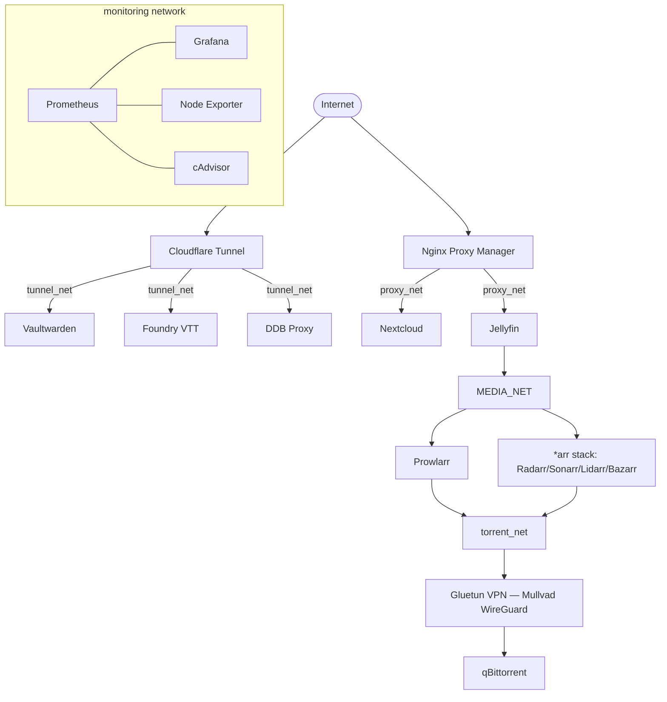

# Gaia Homelab — Infrastructure as Code

[](../../actions)
[](../../actions)
[](../../actions)
[](../../actions)
[](LICENSE)

> This is my home server, managed entirely through Ansible and Terraform instead of manual setup. I built it to practice the workflows I'd actually use in a DevOps/SysAdmin role — idempotent config, secrets handling, CI gating, staging before prod — while learning the field on my own.

---

## Table of Contents
- [Why this project exists](#why-this-project-exists)
- [Architecture](#architecture)
- [Security design decisions](#security-design-decisions)
- [Backup & Disaster Recovery](#backup--disaster-recovery)
- [Tech stack](#tech-stack)
- [Repository structure](#repository-structure)
- [CI/CD pipeline](#cicd-pipeline)
- [Test-before-prod workflow](#test-before-prod-workflow)
- [Getting started](#getting-started)
- [Lessons learned / trade-offs](#lessons-learned--trade-offs)
- [Roadmap](#roadmap)
- [About me](#about-me)

---

## Why this project exists

I'm self-taught in DevOps/sysadmin practices and currently work in a non-technical support role. This repository is where I apply and practice the practices I'd expect to use on the job: idempotent config management, secrets handling, network segmentation, and a CI pipeline that actually gatekeeps changes — instead of a wiki page of manual steps.

Everything here manages a real, currently-running home server (Ubuntu + Docker), not a toy demo.

## Architecture



Traffic is split by trust boundary into isolated Docker networks:

| Network | Purpose |
|---|---|
| `proxy_net` | Public-facing services routed through Nginx Proxy Manager |
| `tunnel_net` | Services published via Cloudflare Tunnel (outbound-only connection, no router port needed) |
| `media_net` | Media server ↔ media request/management apps |
| `torrent_net` | Download stack — **all traffic forced through the Gluetun VPN container**, no direct internet path |
| `monitoring` | Metrics collection, isolated from application traffic |

## Security design decisions

Rather than list every tool, here's the *reasoning* behind the choices that matter most on review:

- **No secrets in plaintext.** All sensitive values live in `ansible-vault`-encrypted `vault.yml`; the vault password is resolved via `get-vault-pass.sh` (env var in CI, OS keyring locally) — same script, both environments.
- **No container controls the Docker daemon.** The only container with Docker socket / cgroup access is cAdvisor, which runs privileged as the upstream deployment requires, isolated on the `monitoring` network. I previously ran Watchtower behind a `docker-socket-proxy`, but removed both: the proxy blocked every write call, so Watchtower could not update anything. A component that looks like protection but does nothing is worse than none, so updates are now done deliberately through Ansible.
- **VPN kill-switch for torrent traffic.** qBittorrent shares Gluetun's network namespace (`network_mode: container:gluetun`) — if the VPN drops, the download client loses connectivity entirely rather than falling back to the host's real IP.
- **Admin UIs bound to loopback.** Nginx Proxy Manager's admin panel, Kopia's web UI, and the `*arr` dashboards are published on `127.0.0.1` only, not the LAN interface.
- **Host hardening.** UFW default-deny inbound, SSH restricted to key-based auth with `PermitRootLogin no`, kernel `sysctl` hardening (SYN cookies, disabled ICMP redirects).
- **CrowdSec (detection only).** The engine reads Nginx and system logs and flags malicious patterns, but no firewall bouncer is deployed yet, so nothing is blocked automatically. Adding a bouncer is on the roadmap.

## Backup & Disaster Recovery

Backups follow a 3-2-1 idea: the data, a second local copy and an offsite copy. A third copy on a Raspberry Pi is planned.

One host cron job (02:00, wrapped in `flock` so runs never overlap) runs a single script from the `backup` role. The steps run in a fixed order:

1. **Consistent database dumps.** Nextcloud: `pg_dump | gzip` into a temp file, checked (`gzip -t`, minimum size) before it replaces the last good dump. Vaultwarden: its built-in `backup` command, because a plain copy of a live SQLite file with a write-ahead log can be inconsistent.
2. **Kopia snapshots** (encrypted, deduplicated) of app data, Nextcloud files, config and the dumps, to a repository on a second physical disk.
3. **Offsite mirror** of the Kopia repository to Backblaze B2 with `kopia repository sync-to`. B2 credentials are passed through a root-only env file, never on a command line.

Every step is attempted even if an earlier one fails. The exit code and a Prometheus metric (`kopia_backup_last_run_failures`) show how many steps failed, so a partial failure is visible in Grafana.

**Restore is tested, not assumed.** I restored Vaultwarden from a snapshot into a throwaway container (login works, all entries present, ~30 min including debugging) and the Nextcloud database into a disposable Postgres (row counts match production, ~11 min). Foundry and a full Nextcloud files restore are not yet drilled.

**Known limitations:** `--delete` makes B2 a mirror, not a version history (a mistake propagates unless local snapshots still hold the data); the Kopia admin password is visible in the container's arguments; Cloudflare Tunnel ingress rules exist only in the Cloudflare dashboard and are not yet in code.

The trigger is a host cron job rather than Kopia's built-in scheduler, which proved unreliable for CLI-managed sources in headless mode.

## Tech stack

| Layer | Tools |
|---|---|
| Configuration management | Ansible, Ansible Vault |
| Infrastructure provisioning | Terraform, libvirt/KVM |
| Containers | Docker, Docker Compose |
| Reverse proxy / ingress | Nginx Proxy Manager, Cloudflare Tunnel |
| Monitoring | Prometheus, Grafana, Node Exporter, cAdvisor |
| Security | UFW, CrowdSec, Gitleaks, Trivy |
| Backup | Kopia, Backblaze B2, cron |
| CI/CD | GitHub Actions |

## Repository structure

```text
.
├── ansible/
│   ├── ansible.cfg
│   ├── site.yml                  # Main playbook (one tag per role)
│   ├── aktualizacia.yml          # OS updates with controlled reboot
│   ├── restore-verify.yml        # Restore verification drill
│   ├── get-vault-pass.sh         # Resolves vault password (CI env var / local keyring)
│   ├── group_vars/
│   │   ├── all/vars.yml          # Shared variables
│   │   └── all/vault.yml         # Ansible Vault — encrypted secrets
│   ├── inventories/
│   │   ├── dev.ini               # Staging (generated by Terraform)
│   │   └── prod.ini.example      # Template — real inventory kept out of git
│   └── roles/
│       ├── bootstrap/            # OS hardening, UFW, sysctl, Docker Engine
│       ├── system/               # CrowdSec, unattended upgrades
│       ├── connection/           # Nginx Proxy Manager, Cloudflare Tunnel
│       ├── vaultwarden/
│       ├── nextcloud/
│       ├── media/                # Jellyfin, *arr stack, Gluetun VPN, qBittorrent
│       ├── monitoring/           # Prometheus, Grafana, exporters
│       ├── foundry/              # Foundry VTT
│       └── backup/               # Kopia, nightly script, B2 mirror
├── terraform/dev/                # Disposable KVM staging VM for pre-prod testing
└── .github/workflows/            # Lint, syntax check, secret scan, config scan, terraform CI
```

## CI/CD pipeline

Every push/PR runs:

| Workflow | What it checks |
|---|---|
| `ansible-lint.yml` | Ansible best-practice linting (`production` profile) |
| `ansible-syntax.yml` | Playbook syntax validation |
| `secret-scan.yml` | Gitleaks — fails the build if a secret is ever committed |
| `security-scan.yml` | Trivy config scan for CRITICAL/HIGH misconfigurations |
| `terraform.yml` | `terraform fmt -check`, `init`, `validate` on any Terraform change |

## Test-before-prod workflow

Changes aren't applied directly to the production host. `terraform/dev` provisions a throwaway Ubuntu VM on local KVM/libvirt, auto-generates its Ansible inventory, and the same `site.yml` playbook runs against it first:

```bash
cd terraform/dev
terraform apply                 # spins up a disposable staging VM, writes ansible/inventories/dev.ini
cd ../../ansible
ansible-playbook site.yml       # default inventory is dev.ini, default target is the staging group
```

The default is deliberately the disposable VM, so a forgotten flag can never touch production. Production has to be chosen explicitly (inventory and host group):

```bash
ansible-playbook -i inventories/prod.ini -e target_hosts=homelab site.yml --check --diff   # dry run
ansible-playbook -i inventories/prod.ini -e target_hosts=homelab site.yml                  # apply
```

### Running a single role

Every role has a tag with the same name, so one component can be applied without touching the rest:

```bash
ansible-playbook site.yml --list-tags                       # available tags
ansible-playbook -i inventories/prod.ini -e target_hosts=homelab site.yml --tags backup --list-tasks   # what would run
ansible-playbook -i inventories/prod.ini -e target_hosts=homelab site.yml --tags backup --check --diff # dry run
ansible-playbook -i inventories/prod.ini -e target_hosts=homelab site.yml --tags "monitoring,backup"   # several roles
ansible-playbook -i inventories/prod.ini -e target_hosts=homelab site.yml --skip-tags media            # everything except one
```

Tags: `bootstrap`, `system`, `connection`, `vaultwarden`, `nextcloud`, `media`, `monitoring`, `foundry`, `backup`.

Two more playbooks live next to `site.yml`: `aktualizacia.yml` (OS package updates with a controlled reboot) and `restore-verify.yml` (restore verification drill).

## Getting started

**Requirements:** Ansible, the `community.docker` and `community.general` collections, Terraform + libvirt (for staging only).

```bash
ansible-galaxy collection install community.docker community.general
```

Copy `ansible/inventories/prod.ini.example` to `prod.ini` and fill in your own hosts, then run as shown above. The vault password is read automatically by `get-vault-pass.sh` (configured in `ansible.cfg`), so no `--ask-vault-pass` is needed. Either export `ANSIBLE_VAULT_PASSWORD` or store it once in the OS keyring: `secret-tool store --label="Ansible vault" ansible vault`.

## Lessons learned / trade-offs

A few decisions here are trade-offs I made consciously, not things I overlooked:

Most images run on `:latest`. That is convenient for a single operator but non-reproducible: a `docker pull` can bring a breaking change. I once had Watchtower for this, then found out (logs full of 403s) that its socket proxy blocked all writes, so it never updated anything; I removed it. Updates are now manual and deliberate via Ansible, and in a team setting I would pin versions and roll out changes through review.

SSH hardening was silently ineffective: `50-cloud-init.conf` set `PasswordAuthentication yes` and, since sshd uses the first value it reads, overrode my `99-hardening.conf`. I found it with `sshd -T` and renamed my file to `00-`. Lesson: verify the effective configuration, not the file you wrote.

Terraform state is kept local, with no remote backend or locking. That's fine as long as I'm the only one touching this infrastructure, but it wouldn't hold up with more than one contributor — I'd move to a remote backend (S3 + DynamoDB lock, or Terraform Cloud) the moment that changed.

Kopia's backup container runs as root. It needs to read appdata directories owned by a different UID per service (Nextcloud, Prometheus, the *arr stack, etc.), and giving it root was simpler than maintaining a per-service permission matrix. A narrower setup is on my list, just not urgent for a single-host backup job.

## Roadmap

- [x] Restore drill for Vaultwarden and the Nextcloud database
- [ ] Restore drill for Foundry and the full Nextcloud files
- [ ] Deploy a CrowdSec firewall bouncer so detections are actually blocked
- [ ] Build a dedicated TrueNAS storage server and use it as the storage backend for the k3s migration (Nextcloud data currently lives in a Docker volume on the SSD)
- [ ] Set explicit CPU/memory resource limits on all containers — also
      direct prep for Kubernetes `resources.requests/limits`
- [ ] Alertmanager rules on top of the existing Prometheus/Grafana stack
- [ ] Centralized logging (Loki + Promtail) alongside existing monitoring
- [ ] Migrate homelab services to k3s, starting single-node on the
      existing host, then evaluating additional nodes
- [x] ~~Molecule tests for Ansible roles~~ — deprioritized: most roles will
      be replaced by Kubernetes manifests/Helm charts during the k3s
      migration, so testing investment will target that layer instead
- [ ] Pin image versions for stateful/critical services (Vaultwarden,
      Nextcloud, Postgres) ahead of full migration; broader version
      pinning is deferred to Kubernetes, where it's inherent to how
      deployments are declared
- [ ] Remote Terraform backend with state locking (low priority — revisit
      if collaborating with others)

## About me

Self-taught in DevOps/sysadmin practices, currently working as a Support Associate. Background in front-end development (AP Degree, Multimedia Design, IBA — Denmark). Looking for a junior/mid-level DevOps or SysAdmin role.

- LinkedIn: https://www.linkedin.com/in/oliver-novos%C3%A1d-59a135223/
- Email: oliver.novosad@gmail.com
